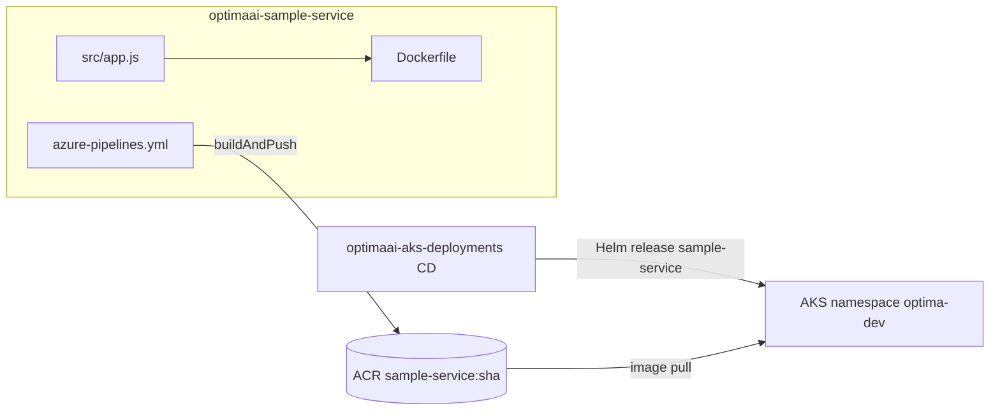
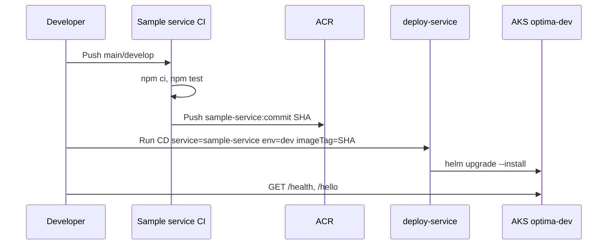

# optimaai-sample-service

Minimal **Node.js / Express** HTTP service used to validate the full Optima delivery path: **service CI → Azure Container Registry (ACR) → central CD → AKS**. It is not a production domain service; use it to prove agents, registry permissions, Helm values, probes, and rollout behavior before onboarding real microservices.

**Related repos**

| Repository | Role |
|------------|------|
| **optimaai-sample-service** (this repo) | App source, tests, Dockerfile, CI push to ACR |
| **optimaai-aks-deployments** | Helm chart, `environments/*/sample-service.yaml`, `deploy-service.yml` CD |
| **optimaai-infrastructure** (Terraform) | AKS, ACR, namespaces, identities (provisioned outside this repo) |

---

## Table of contents

1. [Purpose](#purpose)
2. [Architecture and flow](#architecture-and-flow)
3. [API](#api)
4. [Project structure](#project-structure)
5. [Configuration](#configuration)
6. [Local development](#local-development)
7. [Docker](#docker)
8. [Azure DevOps CI — one-time setup](#azure-devops-ci--one-time-setup)
9. [Steps to build and push an image](#steps-to-build-and-push-an-image)
10. [Steps to deploy to AKS](#steps-to-deploy-to-aks)
11. [Verify after deploy](#verify-after-deploy)
12. [Promotion to QA / UAT](#promotion-to-qa--uat)
13. [Troubleshooting](#troubleshooting)
14. [What this service does not do](#what-this-service-does-not-do)

---

## Purpose

- Confirm **Azure DevOps** can run `npm ci`, `npm test`, and **Docker build/push** on your agent pool.
- Produce an **immutable image tag** (`Build.SourceVersion` = Git commit SHA) in ACR as `sample-service:<sha>`.
- Give **optimaai-aks-deployments** a known-good workload with simple HTTP probes (`/health`).
- Teach the **same CI/CD contract** that other `*-service` repos should follow (see CI template in the deployments repo).

---

## Architecture and flow





**Naming**

| Concept | Value |
|---------|--------|
| Azure DevOps repo | `optimaai-sample-service` |
| ACR repository / image name | `sample-service` |
| Helm release / CD parameter `service` | `sample-service` |
| Default AKS namespace (DEV) | `optima-dev` |

---

## API

Only two routes exist (by design):

| Method | Path | Status | Example body |
|--------|------|--------|----------------|
| GET | `/health` | 200 | `{"status":"ok","service":"optimaai-sample-service"}` |
| GET | `/hello` | 200 | `{"message":"Hello from Optima AI sample service"}` |

**Kubernetes probes** in `optimaai-aks-deployments` point to **`/health`** for both readiness and liveness (unlike most Optima services that use `/health/ready` and `/health/live`).

Any other path returns Express default **404**.

---

## Project structure

```text
optimaai-sample-service/
├── azure-pipelines.yml   # CI: test + push to ACR
├── Dockerfile            # Node 20 Alpine, non-root user
├── package.json
├── src/
│   ├── app.js            # Express routes (/health, /hello)
│   └── server.js         # HTTP server bootstrap
└── tests/
    └── routes.test.js    # node:test coverage for both routes
```

---

## Configuration

| Variable | Default | Description |
|----------|---------|-------------|
| `PORT` | `3000` | HTTP listen port (matches Helm `containerPort` / `targetPort`) |
| `NODE_ENV` | unset locally; `production` in image | Standard Node convention |

No Key Vault, App Configuration, or database — intentional for smoke testing.

---

## Local development

### Prerequisites

- **Node.js 20+**
- **npm**

### Run

```bash
npm ci
npm test
npm start
```

### Manual checks

```bash
curl -s http://localhost:3000/health
curl -s http://localhost:3000/hello
```

### Optional: watch mode

```bash
npm run dev
```

Uses Node `--watch` on `src/server.js` (Node 20+).

---

## Docker

### Build and run locally

```bash
docker build -t sample-service:local .
docker run --rm -p 3000:3000 sample-service:local
curl http://localhost:3000/health
```

### Image details

- Base: `node:20-alpine`
- Multi-stage `npm ci --omit=dev`
- Runs as user **`node`**
- Exposes **3000**
- Command: `node src/server.js`

---

## Azure DevOps CI — one-time setup

### Step 1 — Push this repository

Import or push `optimaai-sample-service` into your Azure DevOps project.

### Step 2 — Variable group

Create **`optima-sample-service-ci`** (Pipelines → Library) and allow the pipeline to use it:

| Variable | Secret? | Description |
|----------|---------|-------------|
| `AGENT_POOL_NAME` | No | Pool with Node, Docker, and ACR network access |
| `ACR_SERVICE_CONNECTION` | No | **Name** of the Docker Registry service connection |
| `ACR_LOGIN_SERVER` | No | Registry host for logs only (e.g. `myregistry.azurecr.io`) |

### Step 3 — ACR repository

Ensure an ACR repository **`sample-service`** exists (or matches `serviceName` in `azure-pipelines.yml`). The build agent’s identity must be allowed to **push**.

### Step 4 — Create the pipeline

1. **New pipeline** → select this repo.
2. **Existing Azure Pipelines YAML** → `/azure-pipelines.yml`.
3. Save.

### Pipeline behavior

| Setting | Value |
|---------|--------|
| **Trigger** | `main`, `develop` |
| **PR builds** | Disabled (`pr: none`) |
| **Image tag** | `$(Build.SourceVersion)` — full commit SHA |
| **Image** | `$(ACR_LOGIN_SERVER)/sample-service:<sha>` (conceptually; push uses service connection) |

CD is **not** in this pipeline; deploy via **optimaai-aks-deployments**.

---

## Steps to build and push an image

1. Commit and push to **`main`** or **`develop`** (or run the pipeline manually on a branch).
2. Open the pipeline run → wait for **Test and publish image** to succeed.
3. From the last step **Publish deploy metadata**, copy:
   - **Image tag** = `Build.SourceVersion` (40-char SHA unless your host shortens display).
4. In **Azure Portal → ACR → Repositories → sample-service**, confirm tag exists.

**Do not** deploy with tag `latest`; CD rejects it.

---

## Steps to deploy to AKS

Prerequisites (platform team):

- Namespaces (e.g. `optima-dev`) exist.
- **optimaai-aks-deployments** CD pipeline and variable group configured ([deployments README](../optimaai-aks-deployments/README.md)).
- `<ACR_LOGIN_SERVER>` replaced in `environments/dev/sample-service.yaml` (and QA/UAT if used).

### Deploy to DEV

1. Azure DevOps → **optimaai-aks-deployments** → pipeline **`deploy-service.yml`** → **Run pipeline**.
2. Parameters:

| Parameter | Value |
|-----------|--------|
| **service** | `sample-service` |
| **environment** | `dev` |
| **imageTag** | Commit SHA from CI (Step 3 above) |

3. Wait for **Validate** (Helm lint/template) and **Deploy** (rollout) to succeed.

Helm values file: `optimaai-aks-deployments/environments/dev/sample-service.yaml`.

---

## Verify after deploy

### From the CD pipeline

- **Deploy** stage should pass `kubectl rollout status deployment/sample-service`.

### With cluster access

```bash
kubectl get pods -n optima-dev -l app.kubernetes.io/instance=sample-service
kubectl port-forward -n optima-dev svc/sample-service 8080:80
curl http://localhost:8080/health
curl http://localhost:8080/hello
```

Service port **80** maps to container **3000** per Helm values.

### Script (deployments repo)

```bash
cd optimaai-aks-deployments
./scripts/verify-deployment.sh sample-service optima-dev
```

---

## Promotion to QA / UAT

Use the **same image tag** (same digest) as DEV:

1. Run CD with `environment=qa`, `service=sample-service`, same `imageTag`.
2. For UAT, run CD with `environment=uat` and complete **Azure DevOps Environment approval** on `optima-uat`.

Values files: `environments/qa/sample-service.yaml`, `environments/uat/sample-service.yaml`.

---

## Troubleshooting

| Symptom | Likely cause | Action |
|---------|--------------|--------|
| CI fails on `npm ci` | Missing `package-lock.json` or wrong Node version | Use Node 20+; commit lockfile |
| Docker push fails | Bad service connection or missing ACR repo | Check `ACR_SERVICE_CONNECTION`, IAM |
| CD rejects tag | Empty tag, `latest`, or invalid chars | Use full CI SHA |
| Pod `CrashLoopBackOff` | Wrong port | Confirm container listens on **3000** |
| Probe failures | Wrong path | Probes must use **/health** for this app |
| `ImagePullBackOff` | Tag not in ACR or wrong repository | Verify `sample-service:<sha>` in ACR |
| Pipeline cannot reach AKS | Private API | Use self-hosted agent pool |

---

## What this service does not do

- No authentication, database, Key Vault, or Azure SDK usage.
- No automatic CD trigger (optional to add later from CI).
- Not registered in API Management by this repo — routing is platform configuration.

Once smoke tests pass, use this repo as a **reference** when scaffolding real microservices: same Dockerfile pattern, immutable tags, and manual CD parameters.

**Full platform deploy guide:** [optimaai-aks-deployments/README.md](../optimaai-aks-deployments/README.md)
